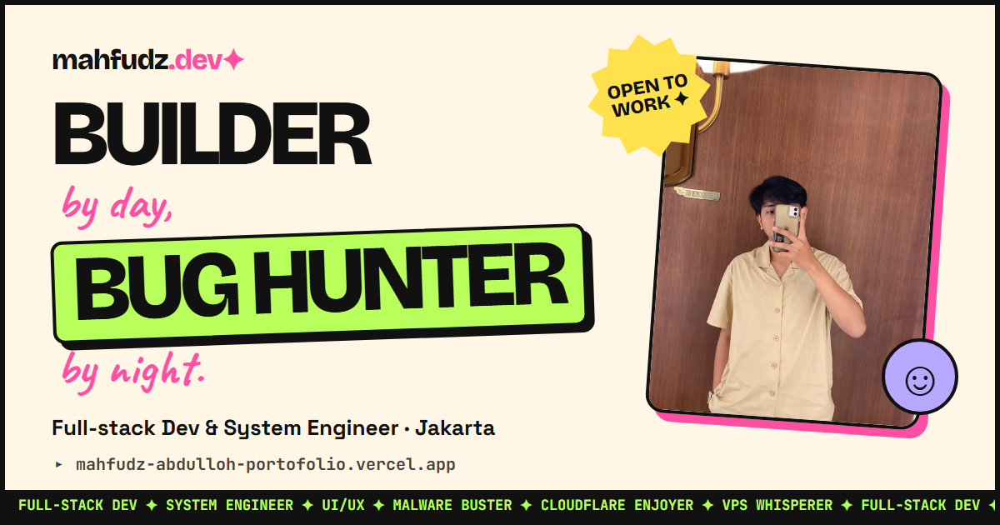

# mahfudz.dev ✦

Personal portfolio of Mahfudz Abdulloh, full-stack developer & system engineer.

**Live:** https://mahfudz-abdulloh-portofolio.vercel.app

A single static page in a neo-brutalist style: plain HTML, CSS and a few lines of JavaScript, with no framework and no build step. Vercel serves the files as they are (see `vercel.json`).

## Run locally

Open `index.html` in a browser.

## Add a project

Copy one `<li class="project card">` block in `index.html`, change the text and image, and set `data-cat` to `web`, `desktop` or `design` so the filter picks it up. Images go in `assets/img/`.

## Deploy

Push to `master`. Vercel deploys it automatically.
